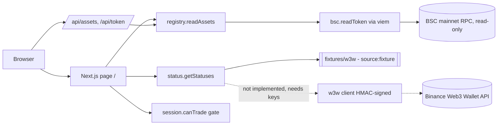

# Architecture (provisional, concept-neutral foundation)

## Trust boundaries
- Solid lines run today. Dotted lines are not implemented or not verified live.
- Token data is read from BSC mainnet. Session data is fixture data and is labeled so in the UI.
- No signing, no private keys, and no transactions exist in this codebase.

## Failure behavior
- RPC failure gives per-asset `read_failed`, never a thrown page error.
- Unknown or closed or halted session blocks trade eligibility (`canTrade`).
- W3W client throws if credentials are absent; there are no retries and a 10 second timeout.

## Decisions
- viem for reads (typed, small). No wallet libraries until a signing flow is approved.
- Fixtures are isolated in `src/lib/fixtures` so they can be deleted without touching logic.
